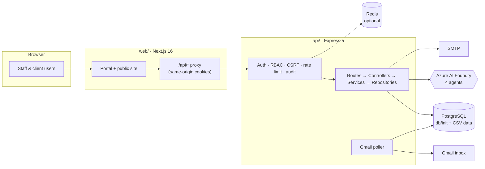
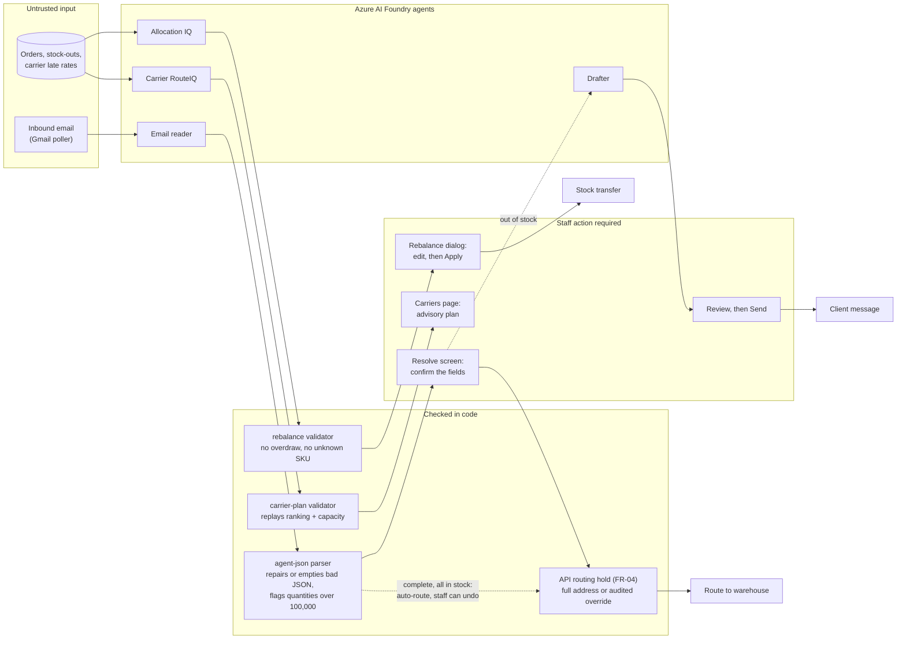

<div align="center">



<br/>


<a href="https://github.com/Evoke-Hackathon-2026/Last-Mile-Labs/actions/workflows/ci-cd-code.yml"></a>
<a href="https://halcyon-web-app-cca2dsb2b0fphybm.westus3-01.azurewebsites.net/"></a>

<p>
  <a href="https://halcyon-web-app-cca2dsb2b0fphybm.westus3-01.azurewebsites.net/"><b>Live app</b></a> ·
  <a href="https://evokemail.sharepoint.com/:v:/r/sites/LearningandDevelopmentTeam2/_layouts/15/stream.aspx?id=%2Fsites%2FLearningandDevelopmentTeam2%2FShared%20Documents%2FHackathon%202026%2FProblem%20Statement%202%2FLast%20Mile%20Labs%2FLast%20Mile%20Labs%20Demo.mp4&nav=eyJyZWZlcnJhbEluZm8iOnsicmVmZXJyYWxBcHAiOiJTdHJlYW1XZWJBcHAiLCJyZWZlcnJhbFZpZXciOiJTaGFyZURpYWxvZy1MaW5rIiwicmVmZXJyYWxBcHBQbGF0Zm9ybSI6IldlYiIsInJlZmVycmFsTW9kZSI6InZpZXcifX0%3D&share=cQq3ngWQOz3YTKBva8ehywWMEgUC-x2dLG3zoMCZv0nXzbIDog"><b>Demo video</b></a> ·
  <a href="#-quick-start"><b>Quick start</b></a> ·
  <a href="docs/SETUP.md"><b>Setup guide</b></a> ·
  <a href="docs/DEMO.md"><b>Demo script</b></a> ·
  <a href="#-the-new-idea-before-and-after"><b>Before and after</b></a> ·
  <a href="#-how-it-works"><b>How it works</b></a> ·
  <a href="#-architecture"><b>Architecture</b></a> ·
  <a href="#-configuration"><b>Configuration</b></a> ·
  <a href="#-engineering-agents"><b>Engineering agents</b></a> ·
  <a href="#-deployment"><b>Deployment</b></a> ·
  <a href="#-reuse-and-scale"><b>Reuse and scale</b></a> ·
  <a href="#-road-to-production"><b>Road to production</b></a> ·
  <a href="SECURITY.md"><b>Security</b></a>
</p>


</div>

<br/>

## ◆ The problem

Halcyon Logistics moves goods for 280 enterprise clients from five warehouses with six carriers. On-time delivery has slipped, clients are complaining, and leadership is about to buy a routing optimiser on the assumption that carriers are to blame.

The data says otherwise. Late deliveries mostly start **before** a parcel reaches a carrier: same-day promises made after the pick-list cutoff, incomplete addresses shipped as-is, and orders filled from a distant warehouse because the nearest one ran out. Halcyon is the operations portal that catches those problems at intake, while there's still time to fix them.

> [!NOTE]
> Everything here runs on a **synthetic hackathon dataset**. No real client, carrier, person or address appears in it. See [`db/data/README.md`](db/data/README.md).


## ◆ The new idea: before and after

**Fix late deliveries where they start, at order intake, not on the road.** Leadership wants a routing optimiser. But routes that run 25% or more over plan account for only 13% of late deliveries, while 65% of late deliveries carry an intake problem. Halcyon checks every order as it arrives, while there is still time to fix it, and ranks carriers per region rather than per route.

### The process

| Step                   | Today                                                                                                    | With Halcyon                                                                                                          |
| :--------------------- | :------------------------------------------------------------------------------------------------------- | :-------------------------------------------------------------------------------------------------------------------- |
| **Email orders**       | Six people retype emails from 14 layouts by hand (44 hours a week)                                       | An AI agent reads each email; staff check and confirm every field on one screen                                       |
| **Same-day promise**   | Accepted until 14:00 and promised for today, though the pick list closes at 08:00. 61% of these are late | The cutoff is enforced at intake. After 08:00 the client is promised the next day, honestly                           |
| **Address**            | Nobody checks it on any channel. 12.4% of orders are incomplete; 65% of those are late                   | Flagged on arrival. Staff send the client a question; the client answers in the portal                                |
| **Warehouse**          | No rule when the nearest is short. 691 orders went far even though the nearest had stock                 | Routes to the nearest warehouse with stock and logs every stock-out. An agent suggests transfers for staff to approve |
| **Carrier**            | Chosen on cost and habit. Carrier D stays on two lanes where it's 45% late                               | Ranked per region from monthly late rates; a same-day plan is ready once the cutoff passes                            |
| **Telling the client** | Clients find out when the parcel is late. 12 of 34 complaints were "not told about the delay"            | An out-of-stock notice with a new date is drafted for staff to send                                                   |

### The result (modelled)

`npm run sim:week` replays real weeks from the dataset twice: once as history shows them, and once under Halcyon's rules. The "before" run matches the dataset's real 71% on-time rate, and the run fails if they drift more than 3 points apart. Figures are the average over 20 simulated weeks; the range is the worst and best week.

| Measure                            | Before | With Halcyon |                                            Change |
| :--------------------------------- | -----: | -----------: | ------------------------------------------------: |
| On time (against the promise)      |  70.8% |        85.0% |                    **+14.2 pts** (+12.7 to +16.1) |
| Late                               |  29.2% |        15.0% |                                         −14.2 pts |
| Same-day promises kept             |  55.4% |        88.2% |                                     **+32.7 pts** |
| Same-day orders delivered that day |  55.4% |        79.8% | **+24.4 pts** (needs the proposed afternoon wave) |

The four rules built into the app give **+12.3 points** on time together; AI stock transfers add +1.9 on top. The afternoon wave adds nothing on time (taking it out raises on-time by 0.4 points). Its value is same-day: without it, same-day orders delivered that day fall by 18.7 points instead of rising by 24.4.

Where the gain comes from, with each rule switched on alone:

| Rule                         | Gain on its own |
| :--------------------------- | --------------: |
| Same-day cutoff              |        +4.5 pts |
| Address questions            |        +4.3 pts |
| Carrier ranking per region   |        +2.0 pts |
| AI stock transfers           |        +1.9 pts |
| Nearest warehouse with stock |        +0.5 pts |
| Afternoon wave (proposed)    |        +0.0 pts |

> [!IMPORTANT]
> This is a model built from history, not a measured result. The transfers' +1.9 assumes approved transfers prevent half of nearest-warehouse stock-outs, a share the data can't give. The afternoon wave is **proposed, not built**: same-day orders complete between 08:00 and 13:00 would be picked at 14:00, up to 15 a warehouse a day, and pick capacity isn't recorded. Until a wave exists, orders after 08:00 are promised the next day, so leadership has to accept fewer same-day deliveries or approve the wave ([`docs/DISCOVERY.md`](docs/DISCOVERY.md), Q3). Full report: [`api/sim-week-2026-11-02.md`](api/sim-week-2026-11-02.md).

### The result in dollars (modelled)

Late deliveries cost Halcyon about **$231k a month** ($2.77M a year) in SLA penalties and redeliveries. With the four rules built today (+12.3 pts), that falls to about **$133k a month** ($1.60M a year): a saving of about **$97k a month, or $1.17M a year**. Across the worst and best simulated weeks, the saving is $84k to $113k a month, or $1.01M to $1.35M a year. With AI transfers as well (+14.2 pts), it's about $112k a month, or $1.35M a year.

| Cost of late deliveries | Before, per month | With Halcyon, per month | Before, per year | With Halcyon, per year | Saving per year |
| :---------------------- | ----------------: | ----------------------: | ---------------: | ---------------------: | --------------: |
| SLA penalties           |             $149k |                    $86k |           $1.79M |                 $1.04M |           $754k |
| Redelivery              |              $81k |                    $47k |            $977k |                  $566k |           $412k |
| **Total**               |         **$231k** |               **$133k** |       **$2.77M** |             **$1.60M** |      **$1.17M** |

How it's worked out (totals are rounded from unrounded figures):

1. **Before:** the dataset's actual $872,460 in penalties and $476,646 in redelivery costs, from 1 April to 25 September 2026 (178 days). Multiply by 365/178 for a year, then divide by 12 for a month.
2. **With Halcyon:** the four built rules cut the simulated late rate from 29.2% to 16.9%, which is 42.1% fewer late deliveries. Both costs are reduced by that share.
3. **Range:** the same sum using the worst and best weeks (+10.7 and +14.3 points) gives 36.6% and 49.0% fewer late deliveries.

> [!IMPORTANT]
> This is a modelled, gross saving, not a measured one. It doesn't subtract the cost of running Halcyon or moving stock. It leaves out the $14.2M of annual revenue at risk and the 461 staff hours a week on complaints, because the data has no way to price either. If a redelivery isn't really charged on every late delivery ([`docs/DISCOVERY.md`](docs/DISCOVERY.md), Q6), the $412k shrinks. At the proposed +6 point target, half the simulated gain, the saving is about **$47k a month, or $568k a year**. Method and assumptions: [`docs/DISCOVERY.md`](docs/DISCOVERY.md), section 5.1.


## ◆ How it works



<table>
<tr>
<td width="50%" valign="top">

### 📥 Email order intake

A Gmail poller copies new mail into Postgres and a Foundry agent extracts the order. Staff resolve it on one screen: map products, fix the address, ask the client a question, pick the ship-from warehouse.

Blank emails, repeats of an email from the last 7 days, and emails with no order in them are set aside under **Ignored** instead of the queue (staff can restore any). The same API order placed twice within 10 minutes gets a 409.

</td>
<td width="50%" valign="top">

### ⏱️ Same-day cutoff

Admins set the cutoff (default **08:00 America/New_York**). Orders before it are promised the same day; later ones honestly promise the next day instead of failing an SLA.

</td>
</tr>
<tr>
<td valign="top">

### 🚚 Carrier plan

Once the cutoff passes, the day's same-day orders and monthly carrier late-rates per region go to a carrier agent, which returns a ranked plan for the Carriers page.

</td>
<td valign="top">

### 📦 Inventory rebalance

An allocation agent reads 30 days of orders and stock-outs and suggests warehouse-to-warehouse transfers. Staff edit, then apply, with an optional in-transit delay.

</td>
</tr>
<tr>
<td valign="top">

### ✉️ Out-of-stock notices

A drafting agent (or a built-in template) writes the customer email proposing a new delivery date, ready for staff to review and send.

</td>
<td valign="top">

### 🧪 Week simulation

`npm run sim:week` replays a realistic week twice, as history shows it and under Halcyon's rules, and reports the on-time difference.

</td>
</tr>
</table>


## ◆ Architecture



| Layer    | Stack                                                                                                    |
| :------- | :------------------------------------------------------------------------------------------------------- |
| **web/** | Next.js 16 App Router (standalone), React 19, TypeScript, Tailwind CSS 4, three.js                       |
| **api/** | Node 24, Express 5, Zod, `pg`, `jose` JWTs, argon2id, helmet, ioredis                                    |
| **db/**  | PostgreSQL schema + seed in 13 idempotent SQL scripts, loaded from the CSV dataset                       |
| **AI**   | Azure AI Foundry agents via `@azure/ai-projects`: email reader, drafter, carrier recommender, allocation |
| **Ops**  | GitHub Actions → two Azure App Services, path-filtered so only the changed app deploys                   |

### How the AI agents are kept in check

Agents suggest; code checks; people decide. An agent can't route an order, move stock or message a client by itself (NFR-01). One path has no person in it: once staff or the client have a request complete, and one warehouse holds every item, the portal routes it automatically, and staff can undo that. Everything else waits on Resolve, and the API refuses to route an incomplete address unless staff override it, which is audited.



### Why we chose these tools

| Tool                                   | Why                                                                                                                                                                                                      | Considered instead                                                                                                  |
| :------------------------------------- | :------------------------------------------------------------------------------------------------------------------------------------------------------------------------------------------------------- | :------------------------------------------------------------------------------------------------------------------ |
| **Next.js 16 (App Router)**            | One app for the public site and the portal. Its `/api` proxy keeps the browser on one origin, so login cookies stay httpOnly and same-site. It builds to a standalone server that App Service runs as is | A plain React SPA: it would need a separate host and cross-site cookies                                             |
| **Express 5 + TypeScript**             | Small, well known, and async errors reach the error handler without wrappers. Strict TypeScript catches shape mistakes between layers                                                                    | NestJS: more structure than a team this size needs. Fastify: faster, but speed isn't the limit at ~300 orders a day |
| **Zod**                                | One schema validates each request and every setting at startup. The API refuses to start on a half-configured feature, and bad input gets a clear 400                                                    | Hand-written checks: easy to miss a field                                                                           |
| **PostgreSQL**                         | The data is relational (orders, clients, warehouses, carriers) and the dataset is CSV, which loads straight in. JSONB holds staff edits and agent replies without a schema change each time              | MongoDB: weak for the joins every report needs                                                                      |
| **Plain SQL with `pg`**                | Every query is visible and tunable; the repositories are thin                                                                                                                                            | An ORM such as Prisma: hides the queries a load test needs to see                                                   |
| **Azure AI Foundry agents**            | Four agents (email reader, drafter, carrier, allocation) live and are versioned outside the code; prompts change without a redeploy. It's in the same Azure tenant as the hosting, with managed identity | Calling a model API directly: prompts would sit in code and need a deploy to change                                 |
| **argon2id + `jose` JWTs**             | argon2id is the OWASP-recommended password hash. Short-lived JWTs in httpOnly cookies, backed by revocable database sessions, so logout and deactivation cut access at once                              | Sessions only: a database read on every request. Long-lived JWTs: can't be revoked                                  |
| **Redis (optional)**                   | Only holds the login rate-limit counters, so they're shared across instances and survive restarts. Off by default; one instance works without it                                                         | Required Redis: one more service for a single-instance deployment                                                   |
| **`node:test` + `pg-mem`**             | Built into Node, no test framework to maintain. `pg-mem` runs the real SQL init scripts in memory, so tests need no database                                                                             | Jest/Vitest with Docker Postgres: slower and harder to run in CI                                                    |
| **Azure App Service + GitHub Actions** | Managed Node hosting with no servers or containers to patch. Path filters deploy only the app that changed                                                                                               | Kubernetes: far more operations work than two small apps need                                                       |

<details>
<summary><b>Repository layout</b></summary>

```
.
├── api/                  Express API (port 4000)
│   ├── src/
│   │   ├── config/       env.ts – every setting validated with Zod at startup
│   │   ├── routes/       All routes, mounted under /api
│   │   ├── controllers/  Request handling
│   │   ├── services/     Business logic, email poller, Foundry agents
│   │   ├── repositories/ SQL access
│   │   ├── middleware/   Auth, RBAC, CSRF, rate limiting, validation, audit
│   │   ├── schemas/      Zod request schemas
│   │   ├── db/           Pool, Redis, db:tables script
│   │   └── sim/          Week simulation
│   ├── test/             node:test suites (tsx)
│   └── .env.example      Every variable, documented
├── web/                  Next.js app (port 3000)
│   ├── public/           Static files, including this README's images
│   └── src/
│       ├── app/(site)/   Public landing page
│       ├── app/(portal)/ Sign-in and /portal
│       ├── app/api/      Same-origin proxy to the API
│       ├── components/   Console (React) + in-browser simulation views
│       └── lib/          API client, auth, simulation engine
├── db/
│   ├── data/             Synthetic CSVs + DATA_DICTIONARY.md
│   └── init/             01–13 SQL: schema, auth, products, emails, settings, carriers, stock, ignored orders
├── e2e/                  Playwright browser tests + run.sh (throwaway stack)
├── docs/
│   └── SETUP.md          Full setup and run guide
├── .github/workflows/    CI/CD to Azure App Service
└── SECURITY.md           Security checks passed
```

</details>


## ◆ Quick start

**One command, with only Docker installed:** this builds and starts Postgres with the dataset, the API and the web app. Then create the first admin, and sign in at [localhost:3000](http://localhost:3000) with the password it prints. With no Node.js, run the same commands as `docker compose up --build --detach --wait` and `docker compose exec api sh docker-entrypoint.sh node dist/db/create-admin.js you@example.com "Your Name"`.

```bash
npm run up
npm run admin:create -- you@example.com "Your Name"
```

> [!NOTE]
> **Setup tested on a clean machine** on 31 October 2026: a fresh clone on an empty Docker host (Docker-in-Docker, no Node.js, no cached images). The no-Node commands above started everything in 140 seconds, the dataset loaded, and the new admin signed in through the web app. The development steps below weren't part of that test.

The first start takes about five minutes. `npm run down` stops it, and `npm run down -- -v` deletes the database too. The database is on port 5434, so it can run beside `halcyon-db` from the steps below. If a port is taken, set `DB_PORT`, `API_PORT` or `WEB_PORT`. Optional features need their settings added to `docker-compose.yml`; `DEMO_MODE` is already passed through. To run the code on your machine instead, for development:

**You need:** Node.js 24+, Docker (for Postgres), and about five minutes.

> [!TIP]
> Want every detail (no-Docker setup, Windows commands, optional features, production build, troubleshooting)? Read the full **[setup and run guide](docs/SETUP.md)**.

**1 · Install**

```bash
npm run install:all
```

**2 · Start PostgreSQL** with the schema and dataset loaded on first boot

```bash
export POSTGRES_PASSWORD=$(openssl rand -hex 16); echo "$POSTGRES_PASSWORD"
docker run -d --name halcyon-db \
  -e POSTGRES_USER=halcyon -e POSTGRES_PASSWORD="$POSTGRES_PASSWORD" -e POSTGRES_DB=halcyon \
  -p 5433:5432 \
  -v "$PWD/db/init:/docker-entrypoint-initdb.d:ro" \
  -v "$PWD/db/data:/data:ro" \
  postgres:17
```

**3 · Configure the API**

```bash
cp api/.env.example api/.env
```

Then set these two:

```dotenv
DATABASE_URL=postgres://halcyon:<the password from step 2>@localhost:5433/halcyon
JWT_SECRET=<run: openssl rand -base64 48>
```

**4 · Create your admin** (once)

```bash
cd api && npm run admin:create -- you@example.com "Your Name" && cd ..
```

It prints a generated password once. Everyone else, including other admins and demo accounts, is added from **Users** in the portal.

**5 · Run**

```bash
npm run dev
```

|        |                                                                         |
| :----- | :---------------------------------------------------------------------- |
| 🌐 Web | http://localhost:3000 → sign in at `/signin` with the admin from step 4 |
| ⚙️ API | http://localhost:4000 · health at `/health` and `/ready`                |

> [!TIP]
> Sign in with the toggle on **Halcyon staff**: the form starts on _Client_, which rejects staff accounts. On Safari over plain `http://localhost`, also set `COOKIE_SECURE=false`.

> [!IMPORTANT]
> The init scripts only run on an **empty** database volume. After the first start, re-apply any script with `psql "$DATABASE_URL" -f db/init/<file>.sql`.


## ◆ Configuration

Only the two variables above are required. Every other feature turns on when its variables are set, and `api/src/config/env.ts` refuses to start on a half-configured feature, so you can't end up with a silently broken setup.

| Feature            | Variables                                                              | When unset                                       |
| :----------------- | :--------------------------------------------------------------------- | :----------------------------------------------- |
| Gmail poller       | `GOOGLE_CLIENT_ID` · `GOOGLE_CLIENT_SECRET` · `GOOGLE_REFRESH_TOKEN`   | No emails arrive                                 |
| Email reader agent | `FOUNDRY_PROJECT_ENDPOINT` · `FOUNDRY_AGENT_NAME` · `FOUNDRY_API_KEY`¹ | Emails stay unread by AI                         |
| Message drafts     | `FOUNDRY_DRAFT_AGENT_NAME`                                             | Built-in template                                |
| Carrier plan       | `FOUNDRY_CARRIER_AGENT_NAME`                                           | No carrier plan                                  |
| Rebalance          | `FOUNDRY_ALLOCATION_IQ_AGENT_NAME` · `STOCK_TRANSFER_DELAY_DAYS`       | Buttons explain it isn't set up                  |
| Email an order     | `SMTP_HOST` + `ORDER_INBOX` · `SMTP_*` · `MAIL_FROM`                   | Option hidden                                    |
| Shared rate limits | `REDIS_URL`                                                            | In-memory, per process                           |
| Demo accounts      | `DEMO_MODE` (default `true`)                                           | On. `false`: none listed, and they can't sign in |

<sub>¹ Optional. Without it, the API uses `DefaultAzureCredential`: `az login` locally, managed identity on Azure.</sub>

<details>
<summary><b>Sessions, cookies and proxies</b></summary>

| Variable                                          | Default                 | Notes                                                                          |
| :------------------------------------------------ | :---------------------- | :----------------------------------------------------------------------------- |
| `ACCESS_TOKEN_TTL_SECONDS`                        | `900`                   | 15 minutes                                                                     |
| `REFRESH_TOKEN_TTL_SECONDS`                       | `604800`                | 7 days                                                                         |
| `COOKIE_SAMESITE`                                 | `lax`                   | Use `none` (with `COOKIE_SECURE=true`) when web and API are on different sites |
| `COOKIE_DOMAIN`                                   | —                       | Share cookies across subdomains                                                |
| `TRUST_PROXY`                                     | `0`                     | `2` on Azure when browsers go through the web app's `/api` proxy               |
| `CORS_ORIGINS`                                    | `http://localhost:3000` | Writes from any other origin are refused                                       |
| `SESSION_RETENTION_DAYS` / `AUDIT_RETENTION_DAYS` | `30` / `365`            | Cleanup runs at start and every 6 hours                                        |

The web app reads `API_URL` (default `http://localhost:4000`) at request time, so it can be changed without a rebuild.

</details>

<details>
<summary><b>Scripts</b></summary>

| Where | Command                                                                   | What it does                                                                                                                                         |
| :---- | :------------------------------------------------------------------------ | :--------------------------------------------------------------------------------------------------------------------------------------------------- |
| root  | `npm run dev`                                                             | API + web together                                                                                                                                   |
| root  | `npm run build`                                                           | Build API, then web                                                                                                                                  |
| root  | `npm run typecheck` / `lint`                                              | Type-check API / lint web                                                                                                                            |
| root  | `npm run test:e2e`                                                        | Browser tests on a throwaway Docker stack                                                                                                            |
| api   | `npm test`                                                                | Run the test suites                                                                                                                                  |
| api   | `npm run admin:create -- <email> ["Name"]`                                | Create the first admin, or recover a locked-out one; prints a generated password once. On Azure: `node dist/db/create-admin.js <email>`              |
| api   | `npm run bench:scale -- --levels 1,10`                                    | Speed and size test: copies the database, fills 1× and 10× six months of orders, measures the API, drops the copy ([`docs/SCALE.md`](docs/SCALE.md)) |
| api   | `npm run db:tables [table] [n\|all]`                                      | Read-only table browser (hashes masked)                                                                                                              |
| api   | `npm run sim:week -- --start 2026-11-02 --seed 7 --runs 20 --out week.md` | Before/after week simulation; add `--agent` for the live carrier agent, `--stock live` to route against today's stock instead of history             |

</details>

<details>
<summary><b>API reference</b></summary>

All routes live under `/api` except the health checks. Every route enforces a role: `admin`, `contributor` or `client`, and clients only ever see their own company.

| Path                                       | Purpose                                                                                                                       |
| :----------------------------------------- | :---------------------------------------------------------------------------------------------------------------------------- |
| `GET /health` · `GET /ready`               | Liveness · readiness (checks the database)                                                                                    |
| `/api/auth/staff/*` · `/api/auth/client/*` | `login` · `refresh` · `logout` · `logout-all` · `me`                                                                          |
| `/api/staff`                               | Admins and contributors                                                                                                       |
| `/api/clients`                             | Clients and their logins                                                                                                      |
| `/api/warehouses` · `/api/products`        | Warehouses, catalogue, stock                                                                                                  |
| `/api/emails` · `/api/order-requests`      | Inbound mail, resolution, client questions, stock flags                                                                       |
| `/api/settings`                            | Same-day cutoff and rules                                                                                                     |
| `/api/carrier-plan`                        | Today's plan · `POST /run` to regenerate · `PUT /carrier` to pick an order's carrier · `POST /assign` to lock the carriers in |
| `/api/rebalance`                           | `suggest` · `apply` · `transfers`                                                                                             |
| `/api/stockouts`                           | Stock-out log                                                                                                                 |
| `/api/simulation`                          | Simulation data and agent calls (admins only)                                                                                 |
| `/api/audit`                               | Audit log                                                                                                                     |

</details>


## ◆ Testing

```bash
cd api && npm test
```

202 tests in 51 suites, all passing. Suites cover auth, RBAC and CSRF security, rate-limit storage, delivery dates, demo settings, the email poller, carrier plans, rebalancing, stock-outs and bad input. Database tests run on `pg-mem`, so no Postgres is needed. CI runs the full API suite on every push to `main` (typecheck → test → build; nothing deploys if a test fails), and lints and builds the web app. See the [CI runs](https://github.com/Evoke-Hackathon-2026/Last-Mile-Labs/actions/workflows/ci-cd-code.yml).

**Main screens in a real browser.** [`e2e/`](e2e/) is a small Playwright suite (28 tests, Chromium). It covers sign-in, the role guards and each main staff and client screen, then follows one order across both portals: New order, My orders, Resolve, and a re-route. It starts its own throwaway stack on ports 3100, 4100 and 5534 and deletes it afterwards, so a stack you already have running isn't touched. CI runs it on a fresh runner, and neither app deploys unless it passes.

```bash
(cd e2e && npm ci && npx playwright install chromium)   # once
npm run test:e2e
```

**Any input, including broken input.** [`samples/`](samples/README.md) holds 59 sample inputs for every intake path: good orders, incomplete addresses, same-day after the cutoff, prompt injection, and broken ones (empty, wrong types, malformed agent JSON, huge quantities). [`api/test/bad-input.test.ts`](api/test/bad-input.test.ts) runs every one through the real routes and validators, and checks the error the user gets and that nothing is written. [`docs/DEMO.md`](docs/DEMO.md) is a 5–7 minute demo script with a table of what each broken input shows on screen.

## ◆ Engineering agents

> [!NOTE]
> Two kinds of agent appear in this project. The **runtime agents** are part of the product: the Azure AI Foundry agents (email reader, drafter, carrier, allocation) that the API calls while it runs, named by the `FOUNDRY_*_AGENT_NAME` settings ([`api/.env.example`](api/.env.example)). The **engineering agents** below are Claude Code subagents in [`.claude/agents/`](.claude/agents/) that helped build and check this repository. They never run in production.



| Agent                                                            | Role                                                                            | Inputs                                                                                                                             | Outputs                                                                                             | Guardrails                                                                                                                                                                                                                                                 | Real output                                                                                                                           |
| :--------------------------------------------------------------- | :------------------------------------------------------------------------------ | :--------------------------------------------------------------------------------------------------------------------------------- | :-------------------------------------------------------------------------------------------------- | :--------------------------------------------------------------------------------------------------------------------------------------------------------------------------------------------------------------------------------------------------------- | :------------------------------------------------------------------------------------------------------------------------------------ |
| [**traceability-writer**](.claude/agents/traceability-writer.md) | Traces every requirement to the screen, API route and test that cover it        | Requirements in [`docs/DISCOVERY.md`](docs/DISCOVERY.md) §6, portal pages, `api/src/routes`, `api/test` and a fresh `npm test` run | Coverage matrix, 20–30 tricky cases with what the code does, gaps ranked by risk                    | Edits only `docs/TRACEABILITY.md`. Confirms screens by reading code, not names. Quotes test names exactly so they can be grepped. Marks anything unconfirmed "not verified"                                                                                | [`docs/TRACEABILITY.md`](docs/TRACEABILITY.md)                                                                                        |
| [**samples-demo-writer**](.claude/agents/samples-demo-writer.md) | Proves the app handles good, edge and broken input on every intake path         | Intake code (email poller, email agent, API order form, Zod schemas, carrier-plan and rebalance validators) and IDs from `db/data` | Sample inputs, a bad-input test suite, a click-by-click demo script                                 | Writes only `samples/**`, `bad-input.test.ts` and `docs/DEMO.md`. Never changes app code: input that is wrongly accepted is documented in the test, not hidden. Must finish with `npm test` and `npm run typecheck` clean                                  | [`api/test/bad-input.test.ts`](api/test/bad-input.test.ts) · [`samples/`](samples/README.md) · [`docs/DEMO.md`](docs/DEMO.md)         |
| [**security-verifier**](.claude/agents/security-verifier.md)     | Re-checks each finding of a security or pentest report against the current code | A report, the code at HEAD, `git log`, `api/test`, `npm audit` for `api/` and `web/`                                               | One row per finding: fixed, open, partly fixed or by design, with file:line evidence and test names | Read-only tools; never edits or commits. The code decides, not the report's wording. Sends requests to localhost only                                                                                                                                      | [`SECURITY.md`](SECURITY.md) · [latest re-check](docs/agent-runs/security-verifier.md)                                                |
| [**dev-agent**](.claude/agents/dev-agent.md)                     | Builds one requirement or fix end to end, with its tests                        | One FR/NFR id or a gap from [`docs/TRACEABILITY.md`](docs/TRACEABILITY.md) §4, the code it touches, `api/.env.example`             | Code in `api/src` or `web/src`, a new or changed test, the TRACEABILITY row to update               | Keeps routes → controllers → services → repositories. Every input goes through Zod. Never edits an existing `db/init` script: adds the next numbered one. Must finish with `npm test`, `typecheck` and web `lint` clean. Never commits; never reads `.env` | [`api/src/schemas/emails.schema.ts`](api/src/schemas/emails.schema.ts) (client answers now get the address check, with two new tests) |
| [**devops-agent**](.claude/agents/devops-agent.md)               | Owns the pipeline, environments and deploy settings                             | `.github/workflows/`, `api/.env.example`, `api/src/config/env.ts`, README › Deployment                                             | Workflow and infrastructure changes, with the README and SETUP sections that describe them          | Tests must gate every deploy. Never prints, echoes or commits a secret; secrets stay in Key Vault or GitHub secrets. Changes nothing in Azure itself. Never commits; never reads `.env`                                                                    | [`docs/SETUP.md`](docs/SETUP.md#run-everything-with-docker)                                                                           |
| [**automation-qa**](.claude/agents/automation-qa.md)             | Runs every automated check, then tests the tricky cases and gaps directly       | `api/test`, `samples/`, [`docs/TRACEABILITY.md`](docs/TRACEABILITY.md) and the unseen-input kit                                    | A dated report with results, findings by severity and owner, and what wasn't run                    | Writes only `docs/qa/`. Tests and reports; never fixes or commits                                                                                                                                                                                          | [`QA-REPORT-2026-10-31.md`](docs/qa/QA-REPORT-2026-10-31.md)                                                                          |
| **CI** ([`ci-cd-code.yml`](.github/workflows/ci-cd-code.yml))    | Runs the agents' tests with everything else before the API deploys              | Each push to `main` that touches `api/`                                                                                            | Typecheck, `npm test`, build, then deploy                                                           | The deploy job needs the build job, so a failing test stops the deploy                                                                                                                                                                                     | [CI runs](https://github.com/Evoke-Hackathon-2026/Last-Mile-Labs/actions/workflows/ci-cd-code.yml)                                    |

The five `halcyon-*` definitions in `.claude/agents/` were each run once on sample input; [`docs/agent-runs/`](docs/agent-runs/README.md) holds what they returned.

Every agent shares three rules: it never commits (a person reviews the diff and commits), it never reads a `.env` file (it uses `api/.env.example`), and it reports what it could not confirm.

## ◆ Deployment

Every push to `main` runs [`ci-cd-code.yml`](.github/workflows/ci-cd-code.yml), which builds and deploys **only the app whose folder changed**:

```
web/  ──▶  lint + next build (standalone) + browser tests  ──▶  Azure App Service   node server.js
api/  ──▶  typecheck + npm test + tsc + prod deps + browser tests  ──▶  Azure App Service   node dist/server.js
```

<details>
<summary><b>One-time setup</b></summary>

**GitHub** → Settings → Secrets and variables → Actions

| Kind     | Name                                                         |
| :------- | :----------------------------------------------------------- |
| Secret   | `AZURE_WEBAPP_PUBLISH_PROFILE` · `AZURE_API_PUBLISH_PROFILE` |
| Variable | `AZURE_WEBAPP_NAME` · `AZURE_API_NAME`                       |

**Azure**, on both App Services: turn on _SCM Basic Auth Publishing Credentials_, set the stack to Node 24, set the startup command above, and leave `SCM_DO_BUILD_DURING_DEPLOYMENT` off. Set `API_URL` on the web app.

**Secrets** live in Azure Key Vault, not in App Service settings. Key Vault names can't contain underscores, so each secret uses hyphens, and the API's app setting of the same name (with underscores) points at it with a Key Vault reference. The API reads them as ordinary environment variables, so no code changes.

| App setting on the API | Key Vault secret       | App setting value                                                                              |
| :--------------------- | :--------------------- | :--------------------------------------------------------------------------------------------- |
| `DATABASE_URL`         | `DATABASE-URL`         | `@Microsoft.KeyVault(SecretUri=https://<vault>.vault.azure.net/secrets/DATABASE-URL/)`         |
| `JWT_SECRET`           | `JWT-SECRET`           | `@Microsoft.KeyVault(SecretUri=https://<vault>.vault.azure.net/secrets/JWT-SECRET/)`           |
| `GOOGLE_CLIENT_SECRET` | `GOOGLE-CLIENT-SECRET` | `@Microsoft.KeyVault(SecretUri=https://<vault>.vault.azure.net/secrets/GOOGLE-CLIENT-SECRET/)` |
| `GOOGLE_REFRESH_TOKEN` | `GOOGLE-REFRESH-TOKEN` | `@Microsoft.KeyVault(SecretUri=https://<vault>.vault.azure.net/secrets/GOOGLE-REFRESH-TOKEN/)` |

The API App Service needs a managed identity with the **Key Vault Secrets User** role on the vault. Its _Environment variables_ page then shows a green tick next to each resolved reference.

**Foundry** has no key. `FOUNDRY_API_KEY` is not set on Azure, so the API signs in to Foundry with the same managed identity (`DefaultAzureCredential`). That identity needs a role on the Foundry project that can run agents.

</details>

## ◆ Security

argon2id passwords · short-lived JWTs in httpOnly cookies · refresh-token sessions with instant revocation · CSRF origin checks · per-IP **and** per-account login limits · role-based access with client isolation · full audit log with retention.

No admin is created from environment variables: the first one comes from `npm run admin:create`, and admins manage everyone else from **Users**.

> [!WARNING]
> **Demo accounts are public.** Any account marked as _demo_, admins included, appears on the sign-in page with a one-click login. A demo admin can't create or promote admins directly (SEC-01), but treat it as a full admin: other account changes can still lead to lasting admin access. These accounts exist only for the hackathon and are deleted when it ends.

## ◆ Reuse and scale

> [!NOTE]
> **Reuse.** A new client needs no code. An admin adds the company and its logins under **Users › Clients**, then loads its products and stock. A new warehouse network is a new deployment with its own data: warehouses, distances, carriers, clients and delivery history, loaded from CSV. The cutoff, time zone, agent instructions and integrations are all settings. The one thing in code is the four US regions (Midwest, Northeast, Southeast, West), so a network in other regions or another country needs a developer. Step-by-step lists and the full split of config, data and code are in [`docs/SCALE.md` › Reuse](docs/SCALE.md#reuse).

> [!NOTE]
> **At 10× today's orders** (333,000 order requests, measured with `npm run bench:scale`), no request fails and every answer is correct. The order screens slow down, though: the staff inbox goes from 0.1 s to 1.6 s, and _My orders_ and the stock-out log take 3 to 3.5 s. The cause is how three queries read data, not database size, and each has a known fix (see Speed and size under [Road to production](#-road-to-production)). Warehouse and carrier capacity at 10× is still unknown and needs numbers from the business. Details: [`docs/SCALE.md`](docs/SCALE.md#what-happens-at-10).

## ◆ Road to production

What it takes to go from hackathon build to running Halcyon Logistics' orders. Ordered by when it's needed. Effort is an estimate of one experienced engineer's working days, and owners are roles to confirm: about 9 days before go-live, and 14 in the first quarter.

### 1 · Before go-live

| Area                  | What's needed                                                                                                                                                                              | Why                                                                                                                                                                                                                                                                                                                                                     | Effort (days) | Owner           |
| :-------------------- | :----------------------------------------------------------------------------------------------------------------------------------------------------------------------------------------- | :------------------------------------------------------------------------------------------------------------------------------------------------------------------------------------------------------------------------------------------------------------------------------------------------------------------------------------------------------ | ------------: | :-------------- |
| **Input limits**      | Done: quantity caps, a stock warning on API orders, and a state, ZIP and country check on them                                                                                             | The sample tests now refuse 5,000,000 cartons on staff edits and an address of "Narnia" ([`samples/README.md`](samples/README.md))                                                                                                                                                                                                                      |             0 | Backend         |
| **Client order list** | Paging on _My orders_ (it shows at most 500)                                                                                                                                               | The 500-request window across all clients is fixed (R-17); a client now sees all their own orders                                                                                                                                                                                                                                                       |             1 | Full-stack      |
| **Web tests**         | Done: a small Playwright suite for the main screens, including New order, My orders and Resolve, run in CI                                                                                 | Every deploy now needs the browser tests as well as the 202 API tests. Resolve with an emailed order that needs fixing isn't covered yet: the Gmail and agent path needs its own test data                                                                                                                                                              |             0 | QA              |
| **Speed and size**    | Rewrite the inbox query to sort and limit each half before joining, store the client on each email at arrival, and narrow the stock-out backfill in SQL ([`docs/SCALE.md`](docs/SCALE.md)) | Measured: at 10× orders nothing fails, but the inbox slows from 0.1 s to 1.6 s and _My orders_ and stock-outs to 3–3.5 s                                                                                                                                                                                                                                |             2 | Backend         |
| **Database**          | Azure Database for PostgreSQL with backups and point-in-time restore. A migration tool in place of init scripts                                                                            | Init scripts only run on an empty database                                                                                                                                                                                                                                                                                                              |             3 | DevOps, backend |
| **Security**          | Turn demo off on every account, admins included. Add MFA for staff (SEC-09) and verify changed email addresses (SEC-06)                                                                    | No logins are seeded: the first admin comes from `admin:create` with a generated password. But a demo account's password is shown on the sign-in page, and staff accounts need a second factor                                                                                                                                                          |             1 | Backend         |
| **Secrets**           | Done. Keep any new secret in Key Vault the same way                                                                                                                                        | The database URL, JWT secret and Gmail credentials are already in Azure Key Vault, and Foundry uses the API's managed identity, so there is no Foundry key (see [Deployment](#-deployment)). No secrets are in the repo: only `api/.env.example` with placeholders is tracked, `.env` is git-ignored, and deploy credentials are GitHub Actions secrets |             0 | DevOps          |
| **Monitoring**        | Application Insights, alerts when the Gmail poller or a Foundry agent fails, and the App Service health check pointed at `/ready`                                                          | The portal falls back to manual work when an integration is down; staff need to know that it has                                                                                                                                                                                                                                                        |             1 | DevOps          |
| **Business sign-off** | The same-day policy (Q3), advisory or automatic carrier booking (Q4), and how long an incomplete order waits for an answer (Q5)                                                            | They change what clients are promised                                                                                                                                                                                                                                                                                                                   |             1 | Leadership      |

### 2 · First quarter

| Area                           | What's needed                                                                                                                         |  Effort (days) | Owner                  |
| :----------------------------- | :------------------------------------------------------------------------------------------------------------------------------------ | -------------: | :--------------------- |
| **EDI intake (FR-11)**         | EDI orders through the same cutoff, address and stock checks. EDI and API are 29% of incomplete addresses                             |              2 | Backend                |
| **Delay alerts (FR-10)**       | Tell clients before the promised date about any known delay, not only stock                                                           |              2 | Full-stack             |
| **Warehouse system link (Q8)** | Write routing decisions back to the warehouse system, rather than staff copying them across                                           |              3 | Backend, Operations IT |
| **AI evaluation**              | A test set of real email layouts (all 14) and adversarial emails; measure extraction accuracy before trusting the agent's output more |              4 | AI engineer            |
| **Capacity numbers (A7, A8)**  | Pick-and-pack time per order, daily capacity per warehouse, and the cost of a stock transfer                                          |              2 | Operations             |
| **Measure the real effect**    | On-time rate weekly against the 71% baseline, split by rule as the simulation does                                                    | 1, then weekly | Operations             |

### 3 · Later

| Area                             | What's needed                                      | Effort (days) | Owner               |
| :------------------------------- | :------------------------------------------------- | ------------: | :------------------ |
| **Early delay warnings (FR-12)** | Carrier delivery events                            |             2 | Backend             |
| **Staff analytics (FR-13)**      | Penalties and at-risk clients                      |             2 | Full-stack          |
| **Routing optimiser (FR-15)**    | Re-size it against the late deliveries that remain |             2 | Leadership, product |


## ◆ License

[ISC](LICENSE). `api/package.json` declares the same licence; keep the two in sync.

<br/>


